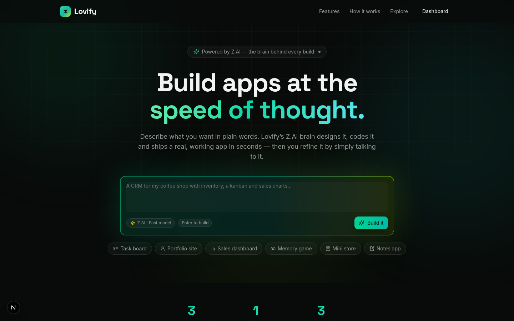
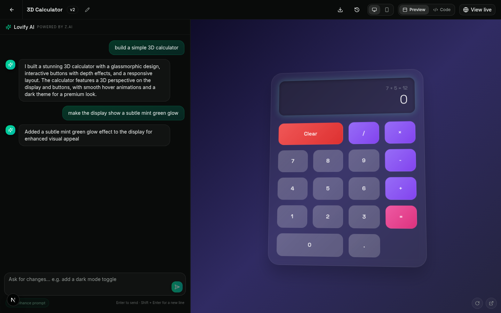
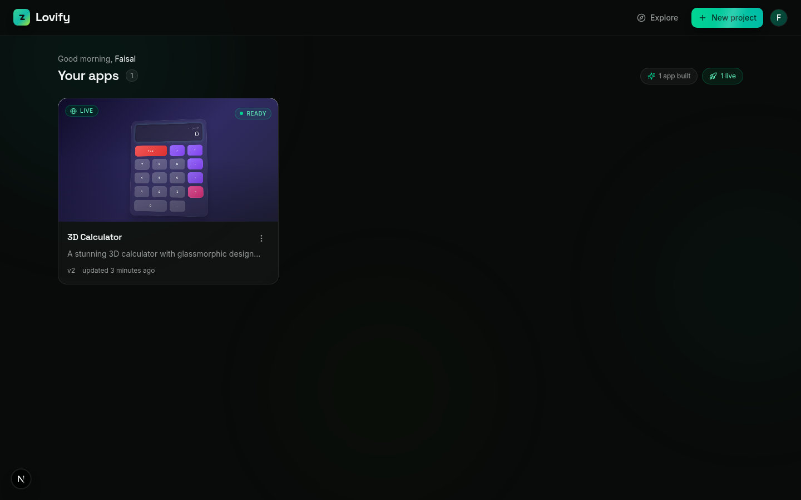
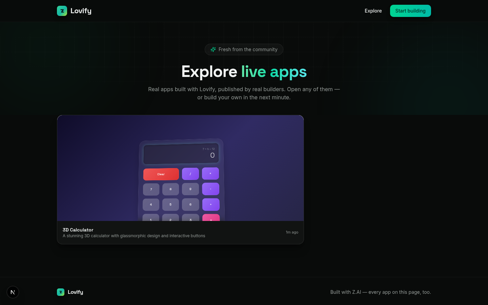

<div align="center">


<!-- typewriter line -->
<a href="https://github.com/faisukhan01/lovable">
  
</a>

**The open-source AI app-builder platform — a Lovable & Base44 alternative, powered by Z.AI as the brain behind every feature.**

[](https://nextjs.org)
[](https://fastapi.tiangolo.com)
[](https://neon.tech)
[](https://z.ai)
[](https://tailwindcss.com)
[](LICENSE)

[Features](#-features) · [Architecture](#-architecture) · [Quickstart](#-quickstart) · [API](#-api-reference) · [Screenshots](#-screenshots)



</div>

---

## What is Lovify?

Lovify turns **one sentence** into a **real, working web app**. Type what you want — a CRM, a game, a portfolio, a store — and the Z.AI brain designs the UI, writes the code and assembles a complete, runnable app in seconds. Then refine it **by chatting**: "make the header glassy", "add search", "switch to a playful vibe". Every change becomes a **version** you can roll back. When it feels right, **publish** it to a public URL with one click.

No boilerplate. No config. No servers. Just describe.

## Features

| | Feature | What it does |
|---|---|---|
| ✦ | **Prompt → Product** | One paragraph becomes a complete, working app with real UI, logic and persistence — not a mockup |
| ⚡ | **Z.AI brain** | Generation, editing and prompt enhancement all run on Z.AI models via a dedicated brain service |
| 💬 | **Iterate by conversation** | "Add a dark mode toggle" → the AI re-architects the app in seconds |
| ✨ | **Prompt Enhancer** | Turn "todo app" into a rich product brief with one click, powered by Z.AI |
| 🎨 | **Design vibes** | One-tap style presets: Elegant dark · Clean light · Playful color · Ultra minimal |
| 👀 | **Live sandboxed preview** | Desktop & mobile frames, refresh and open-in-tab while the AI works |
| 🕰 | **Version history** | Every build is a version — browse the timeline and restore any point |
| 🚀 | **One-click publish** | Every app gets a public URL and appears in the Explore gallery |
| 🌍 | **Explore gallery** | Live, scrollable thumbnails of every published app |
| 🍴 | **Fork & download** | Fork any of your apps or export the HTML — your code, your rules |
| 🔐 | **Auth & accounts** | JWT auth with bcrypt hashing on a real PostgreSQL database |
| 📊 | **Real thumbnails** | Dashboard and gallery render actual live previews of your apps |

## Architecture

```text
┌─────────────────────────────────────────────────────────────────────┐
│                           BROWSER (you)                             │
│   landing · auth · dashboard · builder · explore · /p/{slug}        │
└──────────────────────────────┬──────────────────────────────────────┘
                               │ relative fetches via gateway
┌──────────────────────────────▼──────────────────────────────────────┐
│                      GATEWAY  (single port)                         │
│      /api/*?XTransformPort=8000  ──────────►  FastAPI :8000         │
│      everything else            ──────────►  Next.js :3000          │
└───────────────┬─────────────────────────────────────┬───────────────┘
                │                                     │
┌───────────────▼────────────────┐    ┌───────────────▼───────────────┐
│      FASTAPI  main backend     │    │   NEXT.JS 16  frontend       │
│  · JWT auth (bcrypt)           │    │  · landing / auth pages      │
│  · projects · messages         │    │  · dashboard · builder UI    │
│  · versions · publish/explore  │    │  · service keeper (boots     │
│  · generation pipeline         │    │    the two services below)   │
│  · prompt enhancer · fork      │    └───────────────────────────────┘
└────────┬──────────────┬────────┘
         │              │
┌────────▼───────┐  ┌───▼──────────────────────────┐
│  POSTGRESQL    │  │   Z.AI BRAIN SERVICE :8001   │
│  (Neon cloud)  │  │   z-ai-web-dev-sdk wrapper   │
│  users         │  │  · /generate  create | edit  │
│  projects      │  │  · /chat      enhancer etc.  │
│  messages      │  │  truncation auto-recovery    │
│  versions      │  └──────────────────────────────┘
└────────────────┘
```

**Repository layout**

```text
├── src/app/                 # Next.js 16 App Router (frontend)
│   ├── page.tsx             #   landing
│   ├── auth/                #   sign in / sign up
│   ├── dashboard/           #   your apps (+ live thumbnails)
│   ├── builder/[id]/        #   chat + preview + versions + publish
│   ├── explore/             #   public gallery
│   ├── p/[slug]/            #   published app viewer
│   └── api/boot-services/   #   keeps both services alive
├── mini-services/
│   ├── api/                 # FastAPI backend (port 8000)
│   │   ├── index.py         #   app entry + health
│   │   ├── models.py        #   SQLAlchemy models
│   │   ├── generation.py    #   AI pipeline (background tasks)
│   │   └── routers/         #   auth · projects · public · power
│   └── ai-service/          # Z.AI brain (port 8001, Bun)
│       └── index.ts         #   /generate · /chat
└── docs/screenshots/        # the images you see above
```

## Quickstart

```bash
# 1. Frontend (Next.js 16 + Tailwind 4 + shadcn/ui)
bun install
bun run dev                    # http://localhost:3000

# 2. Z.AI brain service (Bun + z-ai-web-dev-sdk)
cd mini-services/ai-service && bun install && bun run dev   # :8001

# 3. FastAPI backend
python -m venv .venv && source .venv/bin/activate
pip install -r mini-services/api/requirements.txt
cd mini-services/api && uvicorn index:app --port 8000        # :8000
```

Create `mini-services/api/.env` (see `.env.example`):

| Variable | What it is |
|---|---|
| `DATABASE_URL` | Optional. **Leave empty → local SQLite** (`db/lovify.db`) with zero setup. Paste a PostgreSQL connection string (free tier at [neon.tech](https://neon.tech) works great) to go cloud. |
| `JWT_SECRET` | A long random string for signing tokens |
| `AI_SERVICE_URL` | `http://localhost:8001` — the Z.AI brain |

Tables are created automatically on first boot. The Next.js keeper route (`/api/boot-services`) also auto-starts both services and self-heals them.

## API Reference

| Method | Endpoint | Auth | Description |
|---|---|---|---|
| `POST` | `/api/auth/signup` | — | Create account → `{token, user}` |
| `POST` | `/api/auth/login` | — | Sign in → `{token, user}` |
| `GET` | `/api/auth/me` | Bearer | Current user |
| `GET` | `/api/projects` | Bearer | List your apps (`?with_html=1` for thumbnails) |
| `POST` | `/api/projects` | Bearer | Create app from a prompt → AI builds it |
| `GET` | `/api/projects/{id}` | Bearer | Full detail: html + messages + versions |
| `PATCH` | `/api/projects/{id}` | Bearer | Rename |
| `DELETE` | `/api/projects/{id}` | Bearer | Delete app + versions + messages |
| `POST` | `/api/projects/{id}/chat` | Bearer | Iterate: send a change request |
| `POST` | `/api/projects/{id}/restore` | Bearer | Roll back to version N |
| `POST` | `/api/projects/{id}/fork` | Bearer | Clone the app |
| `POST` | `/api/projects/{id}/publish` | Bearer | Publish → public `/p/{slug}` URL |
| `GET` | `/api/projects/{id}/code` | Bearer | Raw HTML |
| `POST` | `/api/enhance-prompt` | Bearer | Z.AI prompt enhancement |
| `GET` | `/api/explore` | — | Public gallery (`?with_html=1`) |
| `GET` | `/api/published/{slug}` | — | Published app HTML |
| `GET` | `/api/stats` | — | Platform counters |
| `GET` | `/api/health` | — | Service + database health |

## Screenshots

| Builder — chat + live preview | Dashboard — live thumbnails |
|---|---|
|  |  |

| Explore — public gallery of live apps |
|---|
|  |

## How the AI builds apps

1. Your prompt (enhanced by Z.AI if you like) hits the FastAPI backend.
2. A background task calls the **Z.AI brain service**, which returns a strict `LOVIFY_META` + `LOVIFY_HTML` payload — a complete single-file app with Tailwind, Lucide icons, animations and localStorage persistence.
3. The backend parses it, bumps the **version**, stores it in PostgreSQL and streams the result into your preview via polling.
4. Truncated outputs are **auto-recovered**: the brain detects the cut and asks Z.AI to regenerate a compact-but-complete version.

## Roadmap

- [x] Prompt → working app
- [x] Chat iteration with version history
- [x] Publish + Explore gallery
- [x] Prompt enhancer + design vibes
- [x] Fork + HTML export
- [ ] Streaming builds (token-level progress)
- [ ] Multi-file project export
- [ ] GitHub sync for generated apps
- [ ] Team workspaces

## Contributing & License

PRs are welcome — the stack is Next.js 16 + TypeScript on the front, FastAPI + SQLAlchemy on the back, Bun for the AI service. MIT licensed.

<div align="center">


⭐ Star the repo if Lovify inspired you — it helps a lot!

</div>
