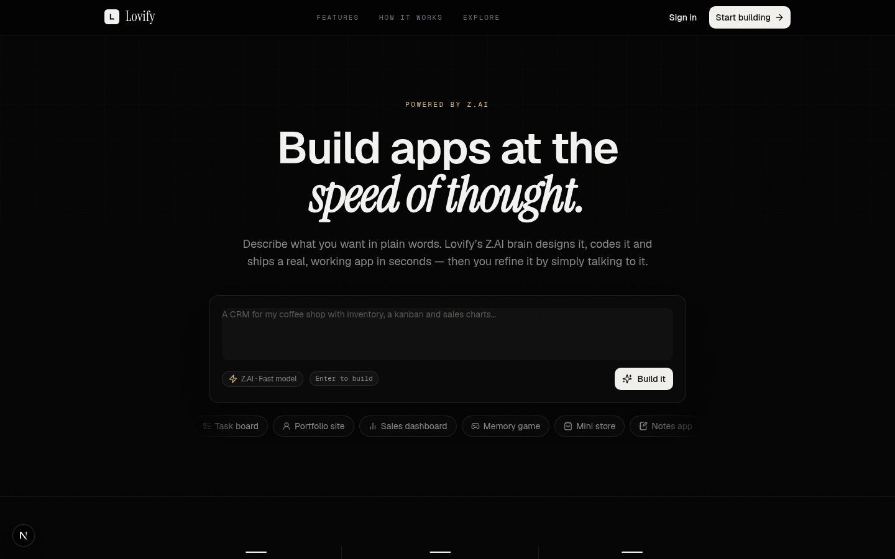
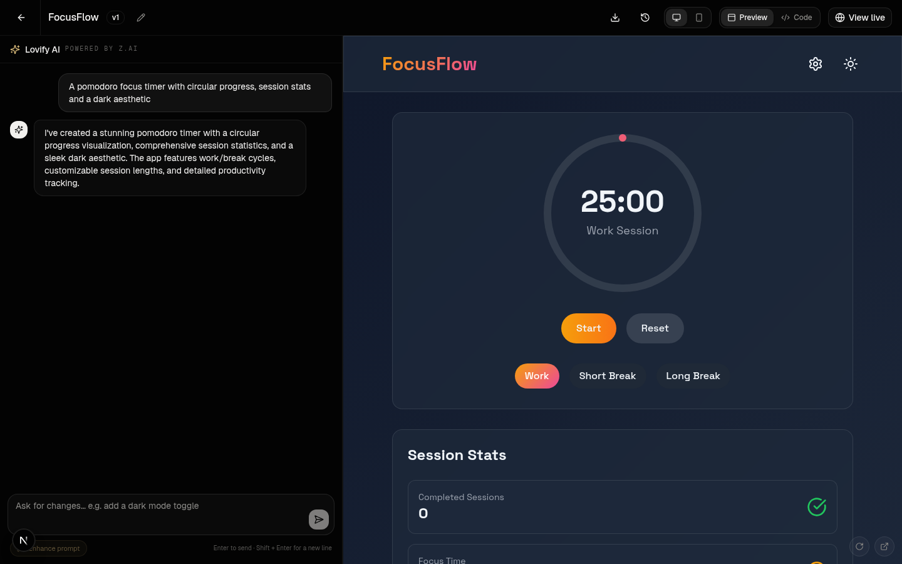
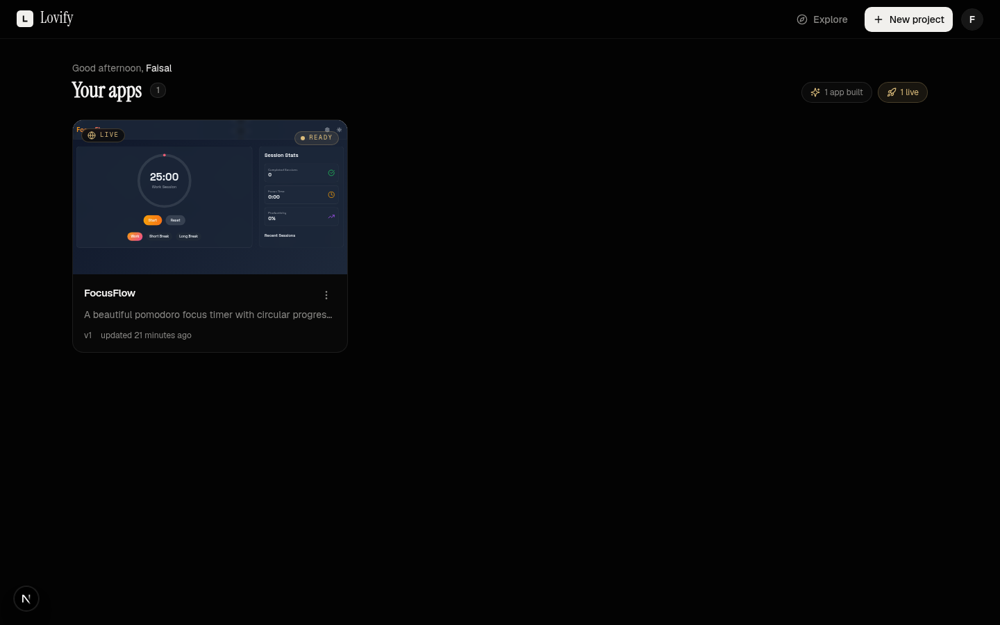
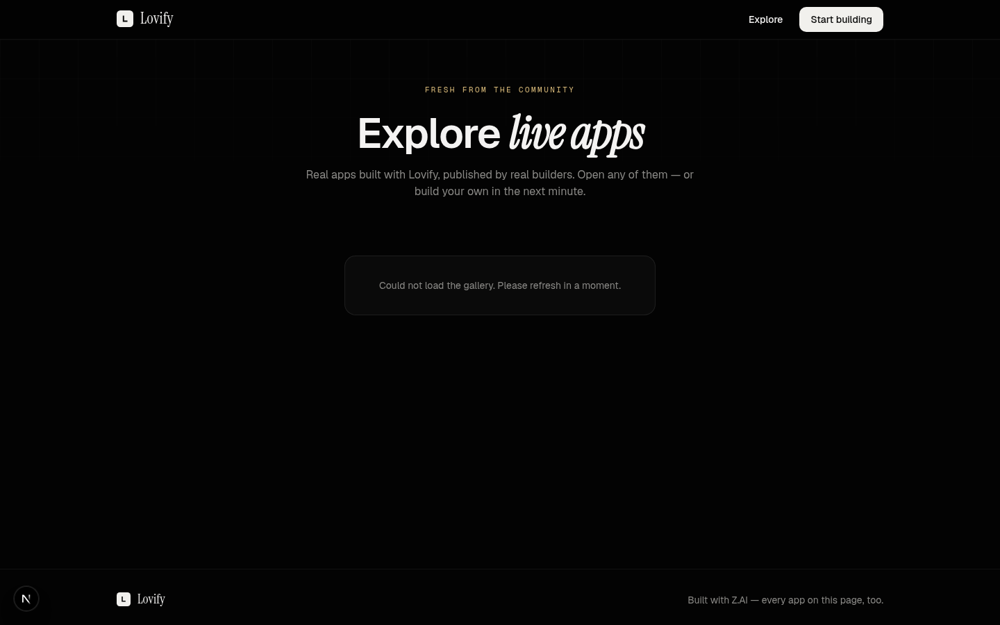
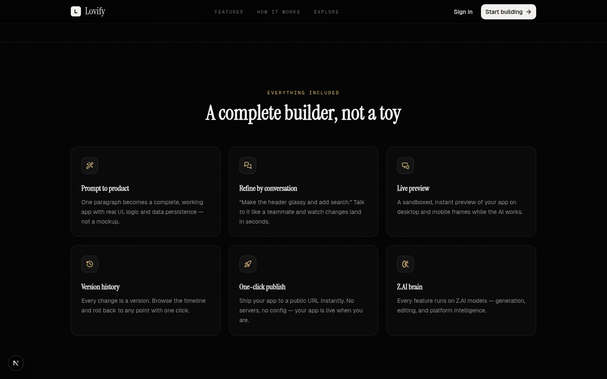
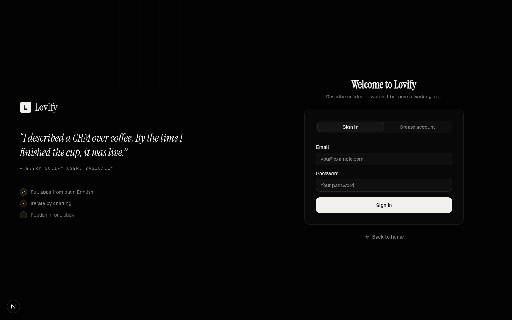
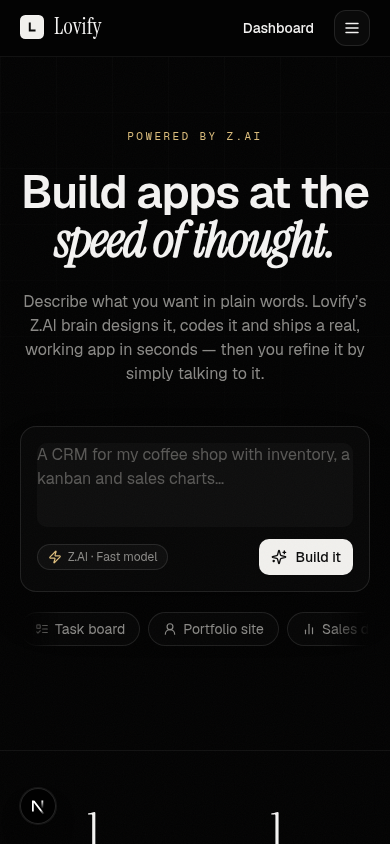
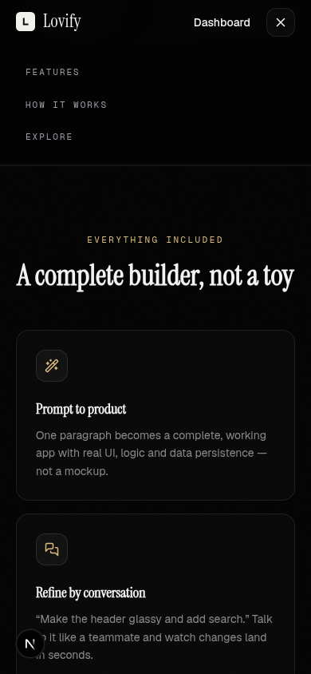

<div align="center">


<!-- typewriter line -->
<a href="https://github.com/faisukhan01/lovable">
  
</a>

**The open-source AI app-builder platform — a Lovable & Base44 alternative, powered by Z.AI as the brain behind every feature.**
**30+ features**: prompt-to-app · chat-only AI · Ask & Plan modes · version diffs · remix · likes · profiles · ⌘K palette.

[](https://nextjs.org)
[](https://www.typescriptlang.org)
[](https://fastapi.tiangolo.com)
[](https://www.postgresql.org)
[](https://www.sqlalchemy.org)
[](https://z.ai)
[](https://tailwindcss.com)
[](LICENSE)

[Features](#-features) · [Tech Stack](#%EF%B8%8F-tech-stack) · [Architecture](#-architecture) · [Quickstart](#-quickstart) · [API](#-api-reference) · [Screenshots](#-screenshots)

<br/>



<br/><br/>

**Zero-config start** — no database URL? Lovify runs on **local SQLite** out of the box. Paste a **PostgreSQL** connection string (free at [neon.tech](https://neon.tech)) when you're ready to go cloud. Same code, one env var.

</div>

---

## What is Lovify?

Lovify turns **one sentence** into a **real, working web app**. Type what you want — a CRM, a game, a portfolio, a store — and the Z.AI brain designs the UI, writes the code and assembles a complete, runnable app in seconds. Then refine it **by chatting**: "make the header glassy", "add search", "switch to a playful vibe". Every change becomes a **version** you can roll back. When it feels right, **publish** it to a public URL with one click.

No boilerplate. No config. No servers. Just describe.

## ✦ Features

### The builder

| | Feature | What it does |
|---|---|---|
| ✦ | **Prompt → Product** | One paragraph becomes a complete, working app with real UI, logic and persistence — not a mockup |
| ⚡ | **Z.AI brain** | Generation, editing and enhancement all run on Z.AI models via a dedicated brain service |
| 💬 | **Iterate by conversation** | "Add a dark mode toggle" → the AI re-architects the app in seconds |
| ✨ | **Prompt Enhancer** | Turn "todo app" into a rich product brief with one click |
| 🎨 | **Design vibes + Templates** | Style presets (Elegant dark · Clean light · Playful · Minimal) and six starter blueprints |
| 👀 | **Live sandboxed preview** | Desktop, tablet **and** mobile frames, refresh and open-in-tab while the AI works |
| 🕰 | **Version history + restore** | Every build is a version — browse the timeline and roll back to any point |
| 🔀 | **Version diff** | Claude Code–style line-level diff (+/−) between any two versions |
| 🧑‍💻 | **Syntax-highlighted code view** | Real source with line numbers, copy, **HTML download** (⌘S) and AI notes |
| 💡 | **Explain this code** | Z.AI reads the file and teaches you how it works — no changes made |
| 🤖 | **Ask mode** | Question your app's code, find bugs, get advice — never edits |
| 📋 | **Plan mode** | `/plan` returns an implementation roadmap before committing to a build |
| 🩹 | **Quick actions + slash commands** | One-tap Fix errors / Polish UI / Make responsive / Dark mode / SEO — or type `/fix` `/polish` `/dark`… |
| 🚀 | **One-click publish + unpublish** | Public `/p/{slug}` URL in one click; take it offline whenever |
| 🍴 | **Fork, duplicate & download** | Clone any of your apps, or export the HTML — your code, your rules |
| ⌨️ | **Keyboard shortcuts** | ⌘K command palette, ⌘S download, Enter to build |

### The community

| | Feature | What it does |
|---|---|---|
| 💬 | **Lovify Chat** | A standalone chat-only AI companion — brainstorm anything, no project needed, history persisted |
| 🌍 | **Explore gallery** | Live thumbnails, **search**, and sort by Newest / Most loved / Most viewed |
| ❤️ | **Likes** | Heart any published app — counts are real, stored server-side |
| 📈 | **View counts** | Every published app tracks its own real traffic |
| 🔀 | **Remix any app** | Clone any published app into your workspace in one click |
| 👤 | **Builder profiles** | Every builder gets a public page at `/u/{handle}` with their published apps |
| 📊 | **Usage dashboard** | Projects, versions, messages, likes received, views received |
| ⚙️ | **Account settings** | Display name, public handle, liked apps, session management |
| ⌘ | **Command palette** | ⌘K anywhere on the dashboard: search projects, run actions |
| 📱 | **Fully responsive** | Mobile-first across every page — builder included (chat ⇄ preview tabs, swipeable toolbars) |
| 🖤 | **MONOLITH design** | Flat, hueless true-black canvas, hairline borders, editorial Instrument Serif display type, Geist UI, Geist Mono meta — and zero gradients |

## ⚙️ Tech Stack

| Layer | Technology | Why |
|---|---|---|
| **Frontend** | [Next.js 16](https://nextjs.org) (App Router) + TypeScript 5 | Server components, streaming, zero-config routing |
| **UI System** | Tailwind CSS 4 + shadcn/ui + Framer Motion | The "MONOLITH" design system — flat true-black surfaces, hairline borders, one champagne-gold accent, ivory primary actions |
| **Backend** | [FastAPI](https://fastapi.tiangolo.com) + Python 3.12 | Async-ready REST API, background task pipeline for AI builds |
| **ORM** | SQLAlchemy 2 (typed, 2.0-style) | `TZDateTime`-safe columns, portable across SQLite and PostgreSQL |
| **Database** | **PostgreSQL** (SQLAlchemy engine) | Production-grade relational store — users, projects, messages, versions, likes. Free cloud hosting via [Neon](https://neon.tech); falls back to local **SQLite** when `DATABASE_URL` is unset |
| **Auth** | JWT (python-jose) + bcrypt (passlib) | 30-day sessions, hashed passwords, Bearer-protected API |
| **AI Brain** | [Z.AI](https://z.ai) via `z-ai-web-dev-sdk` on Bun | Dedicated micro-service (:8001) for generation, editing, chat, Ask/Plan/Explain modes |
| **Typography** | Instrument Serif · Geist · Geist Mono | Editorial display voice + precise UI face + technical meta labels |
| **Styling engine** | Tailwind CSS 4 (OKLCH color tokens) | Flat tokenized palette, hairline borders, film-grain texture — no gradients anywhere |

## Architecture

```text
┌─────────────────────────────────────────────────────────────────────┐
│                           BROWSER (you)                             │
│  landing · auth · dashboard · builder · /chat · explore ·           │
│  /p/{slug} · /u/{handle} · /settings                                │
└──────────────────────────────┬──────────────────────────────────────┘
                               │ relative fetches via gateway
┌──────────────────────────────▼──────────────────────────────────────┐
│                      GATEWAY  (single port)                         │
│      /api/*?XTransformPort=8000  ──────────►  FastAPI :8000         │
│      /chat?XTransformPort=8001   ──────────►  Z.AI brain :8001      │
│      everything else            ──────────►  Next.js :3000          │
└───────────────┬─────────────────────────────────────┬───────────────┘
                │                                     │
┌───────────────▼────────────────┐    ┌───────────────▼───────────────┐
│      FASTAPI  main backend     │    │   NEXT.JS 16  frontend       │
│  · JWT auth (bcrypt)           │    │  · landing / auth pages      │
│  · projects · messages         │    │  · dashboard · builder UI    │
│  · versions · publish/explore  │    │  · Lovify Chat /chat         │
│  · generation pipeline         │    │  · profiles · settings       │
│  · likes · views · remix       │    │  · ⌘K command palette        │
│  · Ask / Plan assistant modes  │    │  · service keeper (boots     │
│  · profiles · usage stats      │    │    the two services below)   │
└────────┬──────────────┬────────┘    └───────────────────────────────┘
         │              │
┌────────▼───────┐  ┌───▼──────────────────────────┐
│  POSTGRESQL    │  │   Z.AI BRAIN SERVICE :8001   │
│  (Neon cloud   │  │   z-ai-web-dev-sdk wrapper   │
│   or SQLite)   │  │  · /generate  create | edit  │
│  users+handles │  │  · /chat      assistant etc. │
│  projects      │  │  truncation auto-recovery    │
│  messages      │  └──────────────────────────────┘
│  versions·likes│
└────────────────┘
```

**Repository layout**

```text
├── src/app/                 # Next.js 16 App Router (frontend)
│   ├── page.tsx             #   landing (30-feature wall)
│   ├── auth/                #   sign in / sign up
│   ├── dashboard/           #   your apps (+ ⌘K palette, templates)
│   ├── builder/[id]/        #   chat (Build/Ask) + preview + code + diff + publish
│   ├── chat/                #   standalone Lovify Chat (chat-only AI)
│   ├── explore/             #   public gallery (search + sort + likes)
│   ├── p/[slug]/            #   published app viewer (like · remix · views)
│   ├── u/[handle]/          #   public builder profiles
│   ├── settings/            #   account, usage stats, liked apps
│   └── api/boot-services/   #   keeps both services alive
├── mini-services/
│   ├── api/                 # FastAPI backend (port 8000)
│   │   ├── index.py         #   app entry + schema migration + health
│   │   ├── models.py        #   SQLAlchemy models (SQLite + PostgreSQL safe)
│   │   ├── generation.py    #   AI pipeline (background tasks)
│   │   └── routers/         #   auth · projects · public · power · social · assistant
│   └── ai-service/          # Z.AI brain (port 8001, Bun)
│       └── index.ts         #   /generate · /chat
└── docs/screenshots/        # the images you see above
```

## Quickstart

```bash
# 1. Frontend (Next.js 16 + Tailwind 4 + shadcn/ui)
bun install
bun run dev                    # http://localhost:3000

# 2. Z.AI brain service (Bun + z-ai-web-dev-sdk)
cd mini-services/ai-service && bun install && bun run dev   # :8001

# 3. FastAPI backend
python -m venv .venv && source .venv/bin/activate
pip install -r mini-services/api/requirements.txt
cd mini-services/api && uvicorn index:app --port 8000        # :8000
```

Create `mini-services/api/.env` (see `.env.example`):

| Variable | What it is |
|---|---|
| `DATABASE_URL` | Optional. **Leave empty → local SQLite** (`db/lovify.db`) with zero setup. Paste a **PostgreSQL** connection string — a free tier at [neon.tech](https://neon.tech) works great — to go cloud. |
| `JWT_SECRET` | A long random string for signing tokens |
| `AI_SERVICE_URL` | `http://localhost:8001` — the Z.AI brain |

Tables are created automatically on first boot — on **PostgreSQL** or SQLite, whichever `DATABASE_URL` points to. The Next.js keeper route (`/api/boot-services`) also auto-starts both services and self-heals them.

## API Reference

| Method | Endpoint | Auth | Description |
|---|---|---|---|
| `POST` | `/api/auth/signup` | — | Create account → `{token, user}` |
| `POST` | `/api/auth/login` | — | Sign in → `{token, user}` |
| `GET` | `/api/auth/me` | Bearer | Current user |
| `PATCH` | `/api/me` | Bearer | Update display name (+ issue public handle) |
| `GET` | `/api/me/usage` | Bearer | Personal usage stats (projects, versions, likes…) |
| `GET` | `/api/me/likes` | Bearer | Apps you liked |
| `GET` | `/api/projects` | Bearer | List your apps (`?with_html=1` for thumbnails) |
| `POST` | `/api/projects` | Bearer | Create app from a prompt → AI builds it |
| `GET` | `/api/projects/{id}` | Bearer | Full detail: html + messages + versions |
| `PATCH` | `/api/projects/{id}` | Bearer | Rename |
| `DELETE` | `/api/projects/{id}` | Bearer | Delete app + versions + messages |
| `POST` | `/api/projects/{id}/chat` | Bearer | Build mode: send a change request |
| `POST` | `/api/projects/{id}/ask` | Bearer | Ask mode: question the app, no edits |
| `POST` | `/api/projects/{id}/plan` | Bearer | Plan mode: implementation roadmap |
| `POST` | `/api/projects/{id}/restore` | Bearer | Roll back to version N |
| `POST` | `/api/projects/{id}/fork` | Bearer | Clone your own app |
| `POST` | `/api/projects/{id}/duplicate` | Bearer | Branch a copy |
| `POST` | `/api/projects/{id}/publish` | Bearer | Publish → public `/p/{slug}` URL |
| `POST` | `/api/projects/{id}/unpublish` | Bearer | Take a live app offline |
| `GET` | `/api/projects/{id}/code` | Bearer | Raw HTML |
| `GET` | `/api/projects/{id}/versions/{n}` | Bearer | Stored HTML of one version (diffs) |
| `POST` | `/api/enhance-prompt` | Bearer | Z.AI prompt enhancement |
| `POST` | `/api/assistant/chat` | Bearer | Chat-only Lovify Chat mode |
| `GET` | `/api/explore` | — | Gallery — `?q=&sort=newest\|liked\|viewed&with_html=1` |
| `GET` | `/api/published/{slug}` | — | Published app HTML (increments views) |
| `POST` | `/api/published/{slug}/like` | Bearer | Toggle like → `{liked, likes}` |
| `POST` | `/api/published/{slug}/remix` | Bearer | Clone any published app into your workspace |
| `GET` | `/api/u/{handle}` | — | Public builder profile + apps |
| `GET` | `/api/stats` | — | Platform counters |
| `GET` | `/api/health` | — | Service + database health |

## Screenshots

| Landing — MONOLITH hero | Builder — chat + live preview |
|---|---|
|  |  |

| Dashboard — live thumbnails | Explore — public gallery |
|---|---|
|  |  |

| Features — serif card titles | Auth — serif editorial quote |
|---|---|
|  |  |

| Landing on mobile | Mobile navigation |
|---|---|
|  |  |

## How the AI builds apps

1. Your prompt (enhanced by Z.AI if you like) hits the FastAPI backend.
2. A background task calls the **Z.AI brain service**, which returns a strict `LOVIFY_META` + `LOVIFY_HTML` payload — a complete single-file app with Tailwind, Lucide icons, animations and localStorage persistence.
3. The backend parses it, bumps the **version**, stores it in **PostgreSQL** (or SQLite) and streams the result into your preview via polling.
4. Truncated outputs are **auto-recovered**: the brain detects the cut and asks Z.AI to regenerate a compact-but-complete version.

## Roadmap

- [x] Prompt → working app
- [x] Chat iteration with version history
- [x] Publish + Explore gallery
- [x] Prompt enhancer + design vibes
- [x] Fork + HTML export
- [x] Premium "MONOLITH" responsive redesign — flat true black, editorial serif type, zero gradients
- [x] Chat-only AI (Lovify Chat), Ask mode, Plan mode
- [x] Version diffs, syntax-highlighted code view, HTML download
- [x] Likes, view counts, remix, builder profiles
- [x] ⌘K command palette, templates, usage dashboard
- [ ] Streaming builds (token-level progress)
- [ ] Multi-file project export
- [ ] GitHub sync for generated apps
- [ ] Team workspaces

## Contributing & License

PRs are welcome — the stack is Next.js 16 + TypeScript on the front, FastAPI + SQLAlchemy + PostgreSQL on the back, Bun for the AI service. MIT licensed.

<div align="center">


⭐ Star the repo if Lovify inspired you — it helps a lot!

</div>
